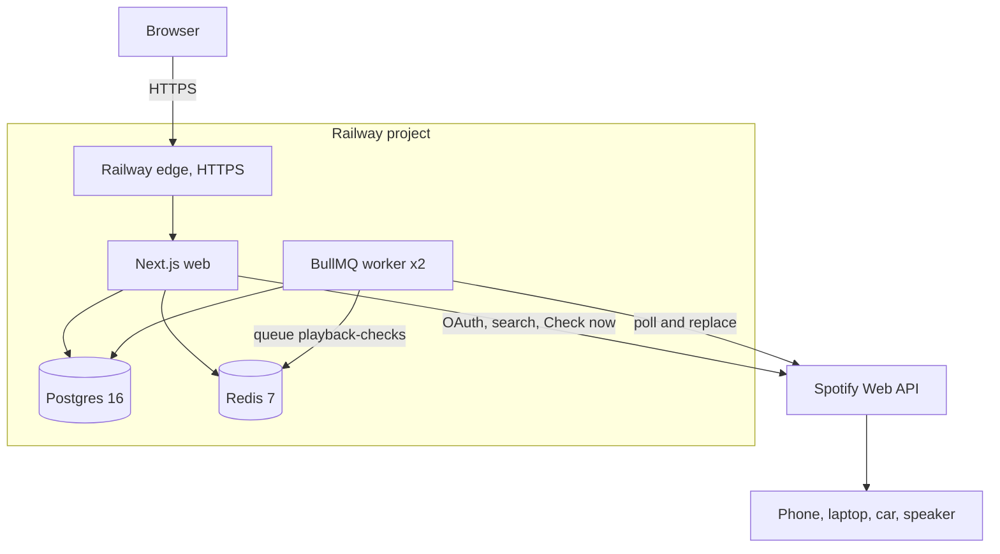
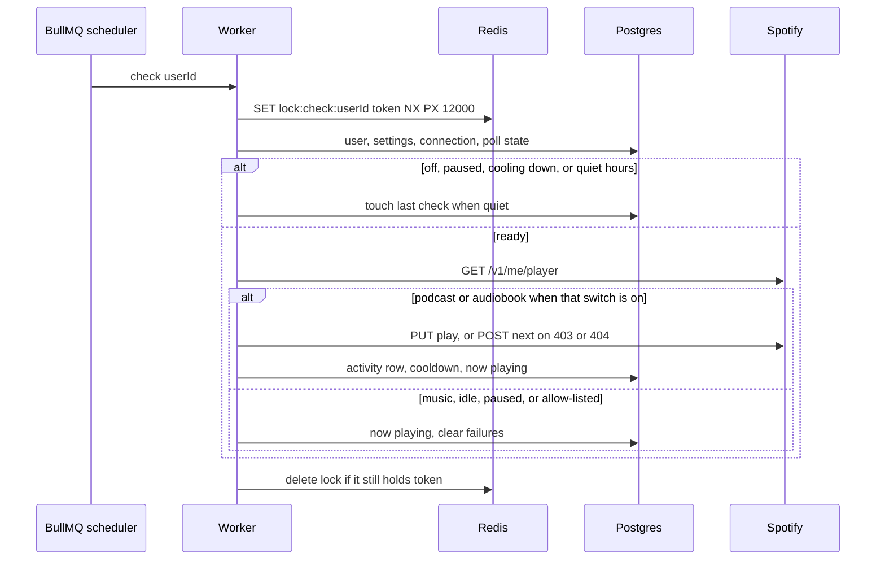

# Architecture

OnlySongs is a server-side watcher for one Spotify account per user. A browser is used to sign in, store that user's Spotify app credentials, and pick a replacement. Playback itself is changed through the Spotify Web API, so the same rule applies on a phone, laptop, car, or speaker.

The design doc covers the stack, the two processes, and the check path. Day-to-day setup is in the [README](../README.md). The test layers and CI jobs are in [TESTING.md](../TESTING.md).

## Tech stack

| Layer | Choice |
| --- | --- |
| Runtime | Node.js 22, TypeScript |
| Web | Next.js 15 App Router, React 19 |
| Data | PostgreSQL 16, Prisma 6 |
| Jobs | BullMQ 5 on Redis 7 |
| Auth | Email and password (bcrypt, cost 12). The session is an HttpOnly cookie, a `jose` HS256 JWT that names a row in `sessions`; revoking the row ends the session. Email verification and password reset use single-use emailed links. Rate limits are Redis counters per account, per account and IP, and per IP. |
| Secrets at rest | AES-256-GCM. The key is `ENCRYPTION_KEY`. |
| Mail | Nodemailer when `SMTP_HOST` is set. Otherwise the notice is a log line. |
| Hosting | Railway: web and worker services, Postgres, and Redis, defined in `.railway/railway.ts`. Railway terminates HTTPS. A self-hosted Compose stack with Caddy 2 and Let's Encrypt remains as an alternative. |
| Packaging | One multi-stage Docker image with production dependencies only, run as the `node` user. `PROCESS=web` or `PROCESS=worker` selects the entrypoint, and a command passed to the container runs instead. Migrations run once per deploy (Railway pre-deploy, or `RUN_MIGRATIONS=1` under Compose). The worker bundle is built with esbuild. |
| Tests | Vitest unit and integration suites, plus a Docker smoke script on `main`. Details are in [TESTING.md](../TESTING.md). |

Local development has no edge proxy. `docker-compose.dev.yml` starts Postgres and Redis only. The web app is `npm run dev` and the worker is `npm run worker` (`tsx` on the TypeScript sources).

## High-level design

Two processes share one database and one Redis.

The **web** process serves the pages and the JSON API. It owns signup, login, Spotify OAuth, settings, the dashboard, and the manual **Check now** action. Check now calls the same check function as the worker, in the web process, and ignores the 15-second cooldown.

The **worker** process does not serve HTTP. On startup it reconciles BullMQ job schedulers with users who have the blocker enabled, and every 5 minutes it restores any scheduler that is missing or has the wrong interval. It writes a Redis heartbeat every 10 seconds, and deletes activity rows older than 90 days every 6 hours. A BullMQ worker consumes the `playback-checks` queue at concurrency 50. The same queue carries `notify` jobs, which send the Reconnect and quota emails outside any check. Unless `DATABASE_URL` sets `connection_limit`, the worker opens up to 20 Postgres connections and the web process up to 10. Each enabled user has one scheduler, `blocker-<userId>`, repeating every `intervalSeconds` (10–300, default 60).

Spotify credentials belong to the user. The server stores the client secret and the OAuth tokens encrypted. The browser receives only the last four characters of the client id. Scopes are `user-read-playback-state`, `user-modify-playback-state`, and `user-read-currently-playing`. The redirect URI is `${APP_URL}/callback/spotify`.

A check is skipped when the blocker is off, the user is inside a quota pause, the cooldown has not elapsed, quiet hours are active, Spotify is disconnected or broken, or no replacement is saved. Otherwise the worker reads `GET /v1/me/player`. Music, silence, and a paused player are left alone. A podcast is replaced when podcast blocking is on. An audiobook is replaced when audiobook blocking is on. Both settings start on. A chapter that Spotify returns as an episode still counts as an audiobook when the item has an audiobook parent or the playback context is an audiobook. One allow list matches either a show id or an audiobook id. The replacement is `PUT /v1/me/player/play` with a track URI or a playlist or album context. A 403 or 404 falls back to `POST /v1/me/player/next`. A Redis lock, `lock:check:<userId>`, stops two checks for the same user from overlapping. It holds a random token for 12 seconds and is released only by its owner, with a compare-and-delete script. A check has 10 seconds from taking the lock for its player calls. A token refresh has its own 25-second timeout and is never cut short by the check, because Spotify can finish a refresh after the caller stops waiting and rotate the refresh token, and that new token would be lost.

The check is split in two. `src/lib/check-plan.ts` is pure: `preflight` applies the gates that need no Spotify call, `decide` turns the player read into a plan, and `settleSwap` turns the play or skip-next result into what to record. `src/lib/blocker-run.ts` does the I/O around them: it reads the user, calls Spotify, and writes the result once (poll state, activity row, then the broken-connection and quota-email side effects). Request bodies are validated with the zod schemas in `src/lib/schemas.ts`.

Token refresh is single-flight per user across web and worker. A refresh takes `lock:refresh:<userId>`, re-reads the connection, reuses an access token another process just stored, and otherwise refreshes with the newest refresh token. `authorizedCall` changes nothing but the stored tokens. When Spotify revokes access, the check marks the connection broken, turns the blocker off, and queues the email. Search and resolve only report the error.

Accounts are independent. One user's 429 or revoked token does not stop the others. Ten consecutive failed checks surface a warning on the dashboard. The failure count resets when a check ends in music, idle, an allow-listed show, or a successful replacement.

### Data

| Table | Role |
| --- | --- |
| `users` | Email, password hash, admin flag, email verified time |
| `sessions` | One row per sign-in: expiry, revoked time, last seen, user agent |
| `auth_tokens` | SHA-256 of each emailed link token, its purpose (`verify_email`, `reset_password`), expiry, and used time |
| `spotify_connections` | Encrypted client secret and tokens, OAuth state, connection status (enum: pending, connected, broken, disconnected) |
| `blocker_settings` | Enabled flag, interval, replacement, podcast and audiobook switches, quiet hours, allow list, time zone |
| `poll_state` | Last check, cooldown, pause (`paused_until` and `pause_reason`: rate_limited or quota), failure count, now-playing snapshot |
| `activity_log` | Swaps and skips, with enum `action` and `result`. Newest first. Kept for 90 days. |

### Request path

Middleware allows `/`, `/login`, `/signup`, `/callback/*`, `/api/health`, and `/api/auth/*` without a session. Other API calls from a signed-out browser get 401. Other pages redirect to `/login`. The session cookie is `pb_session`, SameSite Lax, and Secure only when `APP_URL` is HTTPS.

## Runtime diagram

Production. Playback devices are reached only through Spotify.

Locally there is no edge proxy. The browser talks to `next dev` on `127.0.0.1:3000`, and `tsx` runs the worker beside it. Postgres and Redis still come from Compose.

## Check sequence

Turning the blocker on writes the scheduler and enqueues one immediate job. Turning it off removes the scheduler. **Check now** skips the queue and runs this sequence in the web process.
